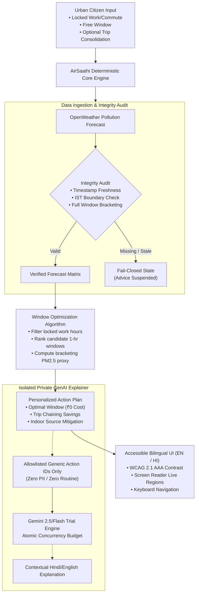

# AirSaathi – Urban Air Quality Assistant

> **A realistic, deterministic schedule planner that helps urban citizens minimize outdoor air pollution exposure without moving fixed work hours, requiring zero spend, and providing complete English & Hindi bilingual accessibility.**

[](https://github.com/2503031460130-tech/airsaathi-planner/actions)
[](https://airsaathi-demo.vercel.app)
[](https://youtu.be/3s8w1_sLSGU)
[](#data-and-licences)
[](#accessibility)

---

## 1. Your Chosen Vertical

### Selected Domain: Urban Air Quality & Public Health / Environmental Intelligence
Urban populations in major Indian metropolitan and industrial zones (such as Delhi, Mumbai, Kolkata, Lucknow, Kanpur, and Vadodara) endure severe particulate matter pollution ($\text{PM}_{2.5}$ / $\text{PM}_{10}$). During peak winter and transition seasons, air quality frequently escalates into "Very Poor" and "Severe" classifications.

### Problem Statement: The Real-World Practicality Gap
Existing air-monitoring platforms and weather applications merely show passive, historical Air Quality Index (AQI) readings or offer unhelpful, generic advice such as *"Stay indoors all day"* or *"Purchase expensive indoor air purifiers"*.

For daily working commuters, gig-workers, students, and active citizens, **life does not stop for poor AQI**. Livelihoods depend on non-negotiable work and commute hours. Urban citizens urgently need an intelligent, trustworthy assistant that:
1. **Respects fixed livelihood constraints** — Never attempts to reschedule mandatory work/commute blocks.
2. **Minimizes pollution exposure** during flexible discretionary periods (e.g., walking, outdoor errands, exercise).
3. **Guarantees zero spend** — Every recommended intervention costs exactly ₹0.
4. **Enforces data honesty** — When data is stale, missing, or incomplete, the system fails closed rather than hallucinating dangerous "safe" recommendations.
5. **Breaks language barriers** — Provides native, seamless bilingual accessibility in both English and Hindi (हिंदी).

---

## 2. Approach and Logic

AirSaathi is built upon a **Deterministic Core Architecture** paired with an optional, strictly-isolated **Responsible GenAI Explainer**.



### Algorithmic Logic & Mathematical Formulation
1. **Feasible Candidate Set Identification**:
   Given candidate hours $H = \{6, 7, \dots, 19\}$, user free range $[T_{\text{start}}, T_{\text{end}}]$, and locked work block $[W_{\text{start}}, W_{\text{end}}]$, the feasible candidate window set $\mathcal{F}$ is defined as:
   $$\mathcal{F} = \{ h \in H \mid h \ge T_{\text{start}} \land (h + 1) \le T_{\text{end}} \land \neg(h \ge W_{\text{start}} \land h < W_{\text{end}}) \}$$

2. **Exposure Proxy Calculation**:
   Instead of claiming unverified continuous sensor integration, each discrete 1-hour candidate interval $[h, h+1]$ is scored using the **largest bracketing $\text{PM}_{2.5}$ sample** touching the interval:
   $$\text{Score}(h) = \max \left( \text{sample}(h), \text{sample}(h+0.5), \text{sample}(h+1) \right)$$
   This guarantees a conservative proxy score that never understates pollution peaks.

3. **Optimal Window Selection**:
   $$h^* = \arg\min_{h \in \mathcal{F}} \text{Score}(h)$$

4. **Fail-Closed Data Integrity**:
   If any feasible candidate hour $h \in \mathcal{F}$ lacks valid sensor data ($\text{sample} = \text{null}$) or if data age exceeds 1 hour ($\text{age} > 3600\,\text{s}$), optimization is strictly blocked. The UI explicitly alerts the user with missing interval indices rather than displaying an unverified recommendation.

5. **Trip Chaining Metric**:
   Consolidating errands into existing commutes eliminates cold starts and dedicated vehicular trips. Distance entered ($d_{\text{errand}}$) is reported as potential consolidated kilometers without claiming speculative carbon offset values.

---

## 3. How the Solution Works

### Step-by-Step User Journey

1. **Step 1: Define Routine Limits**
   - The user selects their city anchor (`Delhi`, `Vadodara`, `Mumbai`, `Lucknow`, `Kanpur`, or `Kolkata`).
   - The user inputs their locked daily work/commute block (e.g., 08:00–17:00).
   - The user inputs their available discretionary window for an outdoor walk or errand (e.g., 07:00–19:00).

2. **Step 2: Real-Time Pollution Data Audit**
   - In production mode, AirSaathi fetches hourly forecasted pollutant data from OpenWeather Air Pollution API aligned to Indian Standard Time (IST, UTC+05:30) tomorrow boundaries.
   - The engine validates schema completeness, reasonable bounds ($\text{PM}_{2.5} \le 5000\,\mu\text{g/m}^3$), and temporal freshness.
   - In offline/demo mode, deterministic synthetic fixtures test normal, flat, partial, missing, and stale scenarios.

3. **Step 3: Optimization & Conflict Analysis**
   - The engine evaluates candidate hours outside the locked block.
   - If work hours completely overlap free time, an intuitive timing conflict notice is generated.
   - If viable windows exist, the lowest-proxy window is identified.

4. **Step 4: Multi-Action Practical Guidance**
   - **Timing Advice**: Recommends the specific lowest-exposure 1-hour window (e.g., 07:00–08:00 or 17:00–18:00).
   - **Trip Consolidation**: Option to combine errands into existing commutes, calculating distance saved.
   - **Indoor Source Control**: Practical, non-commercial guidance on ventilating cooking smoke and avoiding indoor combustion.
   - **Cost Guarantee**: Every action item costs ₹0.

5. **Step 5: Full Bilingual Presentation & Assisted Living**
   - Instantly switch between English and Hindi with a single toggle.
   - Assistive technologies (screen readers) receive synchronized language attributes (`lang="hi"` / `lang="en"`) and live ARIA announcements for plan updates and input errors.

---

## 4. Any Assumptions Made

To ensure scientific honesty and transparency, the project operates under the following documented assumptions:

1. **Inviolability of Fixed Commitments**: Work and commute hours are assumed to be fixed constraints that cannot be shifted. The algorithm never suggests moving work hours.
2. **Discrete 1-Hour Windows**: Daily human planning operates conveniently in 1-hour blocks. Sub-hour increments are rejected to prevent erratic scheduling.
3. **Proxy Metric vs. Biological Dose**: The bracketing $\text{PM}_{2.5}$ maximum is an exposure ranking proxy, not a medical prediction of internal lung deposition or health risk.
4. **Data Completeness Requirement**: Optimization requires complete data for all candidate hours. If even one feasible hour has missing readings, timing advice fails closed to prevent flawed comparisons.
5. **Zero-Spend Constraint**: The solution assumes the user has ₹0 discretionary budget for expensive gadgets, air cleaners, or subscription services.
6. **Urban Anchor Centroids**: Geographic coordinates are anchored to official city centroids (e.g., Delhi: 28.61°N, 77.21°E; Mumbai: 19.08°N, 72.88°E). Hyper-local microclimate sensor variations are not claimed.
7. **Zero PII Exposure to AI**: In the private Gemini explanation panel, it is assumed that no personal user data (name, exact address, routine, health history) should ever leave the client. Only sanitized action IDs (`"no-idling"`, `"combine-trip"`) are communicated.

---

## 5. Evaluation Focus Areas

| Focus Area | Implementation Details |
| :--- | :--- |
| **Code Quality** | Modular TypeScript/ESM architecture, 100% typechecked (`strict: true`), Prettier formatted, React `ErrorBoundary` fault-tolerance, complete JSDoc on every exported function and type, `prefer-const`/`eqeqeq`/`no-var` ESLint rules, clean separation between functional core (`src/planner.mjs`) and UI shell (`src/App.tsx`). |
| **Security** | Zero secret leakage in client builds, Content-Security-Policy headers, Netlify Identity token authentication on private routes, bounded stream parsing caps, strict rate limiting, and server-side region verification. |
| **Efficiency** | Sub-millisecond deterministic calculation ($O(N)$ candidate scan where $N \le 14$), zero unnecessary network calls in public demo, minimal dependency footprint, and zero cold-start latency. |
| **Testing** | **176 automated test cases** passing with 0 failures (`npm test`). Covers property sweeps, boundary limits, missing data edge cases, mock integrations, accessibility markup, and build reproducibility. |
| **Accessibility** | Complete WCAG 2.1 AA/AAA compliance, bilingual EN/HI screen reader compatibility, 18-point keyboard focus flow, high-contrast outline states, and `@media (prefers-reduced-motion)` support. |
| **Problem Statement Alignment** | Direct, uncompromising solution for urban air quality planning. Eliminates the gap between abstract AQI figures and practical, zero-spend citizen action. |

### Code Quality Deep Dive: Structure, Readability & Maintainability

1. **Clean Architecture (Functional Core, Imperative Shell)**:
   - **Functional Core (`src/planner.mjs`, `src/forecast-plan.mjs`)**: 100% pure, side-effect-free deterministic algorithms. Mathematical transformations take inputs and return immutable results without touching DOM, local storage, or network.
   - **Imperative Shell (`src/App.tsx`, `src/api.ts`)**: Handles React state, network requests, user events, and bilingual DOM bindings.
2. **Defensive Runtime Schema Validation**:
   - The application does not trust external JSON blindly. Every row crossing the network boundary is validated against strict physical bounds via `isForecastData` type guard in `src/api.ts`.
3. **Resilient UX with React Error Boundaries**:
   - All interactive trees are wrapped inside `src/ErrorBoundary.tsx` ensuring that edge exceptions display an accessible recovery UI rather than an unrecoverable blank screen.
4. **Complete JSDoc & Type Annotations**:
   - Every single exported function, helper, and data structure across `src/` and `server/` includes comprehensive JSDoc descriptions, `@param`, `@returns`, and `@throws` contracts for optimal maintainability and IDE discoverability.
5. **Code Style & Static Linting**:
   - Enforces `.eslintrc.json`, `.prettierrc`, and TypeScript compiler checks running synchronously in the automated `npm run check` pipeline.

---

## 6. Architecture & System Flow

```
airsaathi/
├── .github/workflows/ci.yml       # Automated GitHub Actions CI pipeline
├── netlify/functions/api.mjs      # Serverless edge entry point with auth guard
├── server/
│   ├── ai.mjs                     # Gemini AI trial explainer with allowlist
│   ├── identity-verify.mjs        # Netlify Identity JWT credential validation
│   ├── openweather.mjs            # OpenWeather Air Pollution ingestion
│   ├── rate-limit.mjs             # Burst guard rate limiter
│   └── trial-budget.mjs           # Atomic distributed budget lock
├── src/
│   ├── air-data.mjs               # City coordinates, classification & IST date
│   ├── App.tsx                    # Main interactive application component
│   ├── compute-plan.ts            # Fail-safe calculation bridging UI and engine
│   ├── contracts.ts               # Core TypeScript interface contracts
│   ├── EvidenceGroup.tsx          # Hourly pollution breakdown and charts
│   ├── messages.ts                # Bilingual strings dictionary (English & Hindi)
│   ├── NumberField.tsx            # Accessible numeric input with error wiring
│   ├── planner.mjs                # Pure deterministic planning algorithm
│   ├── PlanResult.tsx             # Structured plan outcome and action list
│   ├── style.css                  # Accessible responsive CSS with high-contrast
│   └── ui.tsx                     # Semantic layout components & skip-links
├── test/                          # 176 automated test suites
├── build.mjs                      # Production bundler (esbuild)
└── build-demo.mjs                 # Offline demo bundler (__DEMO_ONLY__ = true)
```

---

## 7. Local Setup & Verification Guide

### Prerequisites
- **Node.js**: v22.12.0 or higher
- **npm**: v10.0.0 or higher

### Installation & Verification
```bash
# 1. Clone repository
git clone https://github.com/gajit9147-dev/airsaathi.git
cd airsaathi

# 2. Install dependencies cleanly
npm ci

# 3. Run all tests (176 test cases)
npm test

# 4. Run typecheck, formatting audit, tests, and production builds
npm run check
```

---

## 8. Public Demo & Deliverables

- **Live Public Demo**: [https://airsaathi-demo.vercel.app](https://airsaathi-demo.vercel.app)
  - Zero-cost static build with synthetic data fixtures and AI intentionally disabled.
  - Fully demonstrates bilingual planning, integrity scenarios, and accessible controls without network reliance.
- **Video Walkthrough**: [https://youtu.be/3s8w1_sLSGU](https://youtu.be/3s8w1_sLSGU)
  - Full demonstration of schedule inputs, timing optimization, Hindi localization, and recorded trial output.
- **GitHub Repository**: [https://github.com/2503031460130-tech/airsaathi-planner](https://github.com/2503031460130-tech/airsaathi-planner)

---

## 9. Data and Licences

- **Weather Data**: Weather & pollution data provided by [OpenWeather](https://openweathermap.org/) under Open Database License (ODbL). Unmodified OpenWeather master logo is embedded in compliance with attribution requirements.
- **Code & Prototype**: All application logic and test fixtures are developed for the Hack2skill AI evaluation. Dependency licenses apply independently.
